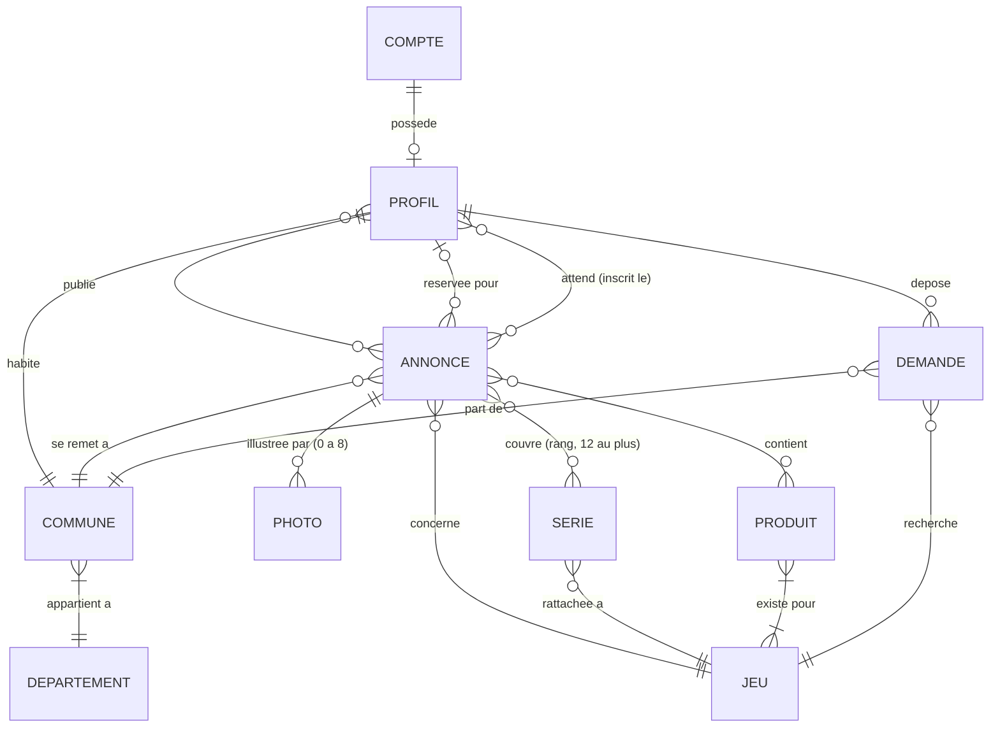
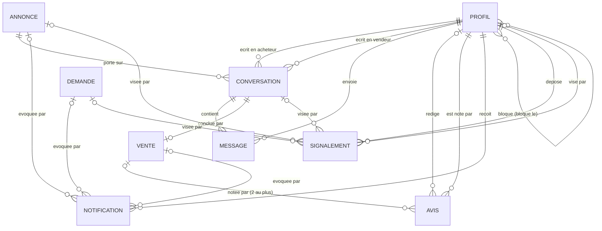

# MCD — Modèle conceptuel des données

Le modèle conceptuel de BulkTCG, déduit du code et non de la base : chaque entité,
propriété et association correspond à quelque chose que l'application affiche, écrit ou
promet de garder. La source est citée à chaque fois. Le MLD ([MLD.md](MLD.md)) le traduit
en relations, le MPD ([MPD.md](MPD.md)) en tables PostgreSQL.

Conventions de lecture :

* les entités sont en capitales (ANNONCE), les associations nommées par un verbe
  (PUBLIE) ;
* l'identifiant d'une entité est **en gras** ;
* une cardinalité `(min,max)` se lit **depuis l'entité vers l'association** : PROFIL
  `(0,n)` PUBLIE veut dire qu'un profil publie de zéro à plusieurs annonces ;
* les noms techniques entre parenthèses sont ceux de la base (`listings.price_cents`),
  pour la traçabilité ; le vocabulaire est celui de l'interface.

## 1. Périmètre

Dans le modèle : tout ce qui est saisi, choisi ou conservé — comptes, profils publics et
fiches boutique, annonces et leurs photos, séries et produits, demandes de recherche,
conversations, ventes clôturées et avis, liste d'attente, notifications, blocages,
signalements, réglages d'alerte, et les trois référentiels (communes, séries, produits
par jeu).

Hors du modèle, parce que calculé à chaque lecture et jamais stocké (règle du README :
« Les chiffres ne sont jamais stockés ») : le **croisement** lot / demande
(`src/lib/matching.ts`), les distances, le nombre d'annonces actives d'un vendeur, le
montant « Vendu ici », les compteurs du suivi du compte, les références citables
`BK-…` et `RC-…` (dérivées de l'identifiant, `src/lib/data/mappers/shared.ts`). Hors du modèle
aussi, parce que gérés ailleurs : l'e-mail et le mot de passe (Supabase Auth), le contenu
des fichiers photo (Cloudflare Images ; leur registre technique, `photo_uploads`, qui dit à
qui appartient chaque fichier, est décrit au [MPD](MPD-annonces.md)), le paiement (pas encore
construit).

## 2. Domaines de valeurs

Listes fermées : une valeur inconnue est refusée à l'écriture et lève à la lecture
(`narrow`, `src/lib/data/mappers/shared.ts`). Libellés : `src/lib/labels.ts`, seul endroit où
elles deviennent françaises.

| Domaine | Valeurs (code → libellé) | Porté par |
|---|---|---|
| Format de lot | `bulk` Vrac, `binder` Classeur, `deck` Deck, `sealed` Scellé, `mixed` Lot mixte | ANNONCE, DEMANDE |
| État | `NM`, `EX`, `LP`, `MP`, `HP`, `sealed` Scellé, `mixed` États mêlés | ANNONCE |
| Langue | `VF`, `EN`, `JP`, `mixed` Langues mêlées | ANNONCE |
| Statut d'annonce | `available` Disponible, `reserved` Réservé, `sold` Vendu | ANNONCE |
| Audience | `everyone` Tout le monde, `pros` Professionnels uniquement | ANNONCE |
| Statut de demande | `open` En recherche, `fulfilled` Trouvé, `closed` Abandonnée | DEMANDE |
| Type de compte | `individual` Particulier, `pro` Professionnel | PROFIL |
| Nature de la vente | `sale` Vente, `trade` Échange | VENTE |
| Rôle noté | `seller` Vendeur, `buyer` Acheteur | AVIS |
| Sorte de notification | `listing_available`, `deal_closed`, `review_received`, `wanted_match`, `listing_expiring` | NOTIFICATION |
| Cible de signalement | `listing`, `profile`, `conversation`, `wanted` | SIGNALEMENT |
| Motif de signalement | `scam`, `counterfeit`, `misleading`, `stolen_photos`, `harassment`, `other` | SIGNALEMENT |

JEU et PRODUIT sont aussi des listes fermées, mais ce sont des **entités** : elles
participent à des associations (une série appartient à un jeu, un produit existe pour
certains jeux).

## 3. Entités

### COMPTE — le compte d'authentification

| Propriété | Domaine | Remarque |
|---|---|---|
| **identifiant** | UUID | attribué par Supabase Auth ; c'est aussi celui du profil |
| e-mail, mot de passe | — | gérés par Supabase Auth, hors du schéma public |

Source : `src/app/inscription/page.tsx`, `src/app/connexion/page.tsx`,
`src/lib/data/session.ts`.

### PROFIL — ce que les autres voient, et les réglages du titulaire

| Propriété | Domaine | Oblig. | Remarque |
|---|---|---|---|
| **identifiant** | UUID | oui | celui du COMPTE |
| pseudo (`username`) | 3 à 24 car. `[a-z0-9._-]` | oui | unique ; finit dans le filigrane des photos |
| initiales (`avatar_initials`) | texte | oui | tirées du pseudo à l'écriture |
| présentation (`bio`) | ≤ 280 car. | non | absente plutôt qu'une chaîne vide |
| type de compte | Type de compte | oui | particulier par défaut ; « pro » une fois le SIRET vérifié — le statut, gratuit, qui porte le badge |
| nom de boutique (`company_name`) | 2 à 80 car. | si pro | présent si et seulement si le compte est pro |
| SIRET | 14 chiffres | non | vérifié auprès du répertoire des entreprises quand la boutique déclare son statut, un par compte ; « — » tant qu'absent |
| raison sociale (`legal_name`), vérifié le (`pro_verified_at`) | texte, date-heure | non | écrits par la vérification ; la raison sociale manque quand le répertoire la masque |
| adresse, horaires, site de la boutique | texte, `https://…` | non | fiche boutique, publique tant que le compte est professionnel |
| pages Cardmarket et CardNexus | `https://…` | non | déclarées par la boutique, affichées comme telles |
| fin du forfait (`pro_until`) | date-heure | non | c'est elle qui ouvre les lots réservés, pas le statut ; suppose le statut |
| créé le | date-heure | oui | |
| ventes (`sold_listing_count`) | entier ≥ 0 | oui | historique du compte, survit aux annonces supprimées |
| alerte croisements, alerte messages | booléens | oui | **privées**, cochées par défaut |

Propriétés calculées, conservées pour la lecture (voir MLD, dénormalisations) : note
globale et note par critère (`rating_avg`, `punctuality_avg`…), nombre d'avis.

Source : `src/types/profile.ts`, `src/lib/schemas/profile-form.ts`,
`src/app/mon-compte/profil/page.tsx`, `src/app/mon-compte/parametres/page.tsx`
(section « Alertes »), README « Offre professionnelle ».

### DÉPARTEMENT et COMMUNE — le référentiel géographique

| Entité | Propriétés | Remarque |
|---|---|---|
| DÉPARTEMENT | **code** (`84`, `2A`…), nom | filtre `departmentCode`, lots voisins « même département » |
| COMMUNE | **slug** (`avignon`), nom, code postal, latitude, longitude | le couple nom + code postal est unique ; coordonnées du centre-ville |

Source : `src/lib/cities.ts` (« En phase 2, la même question est posée à la table des
communes »), `src/lib/geo.ts`, pages `/[game]/[city]`.

### JEU, SÉRIE, PRODUIT — les référentiels du catalogue

| Entité | Propriétés | Remarque |
|---|---|---|
| JEU | **code** (`pokemon`…`other`), libellé, rang d'affichage | liste fermée, dans l'ordre de `GAME_IDS` ; « Autre » ferme la liste |
| SÉRIE | **identifiant** (`pokemon-ev08`), code (`EV08`), nom, année, bloc, rang | l'identifiant porte le jeu : « NEO » existe chez Pokémon et chez Magic |
| PRODUIT | **code** (`etb`, `playmat`…), libellé | ce qui part avec les cartes : display, coffret, tapis… |

Source : `src/types/game.ts`, `src/types/edition.ts`, `src/lib/editions.ts`,
`src/lib/product-tags.ts`, README « Séries et produits ».

### ANNONCE — le lot mis en vente

| Propriété | Domaine | Oblig. | Remarque |
|---|---|---|---|
| **identifiant** | UUID | oui | |
| lien permanent (`slug`) | texte d'URL | oui | unique, ne change jamais, même si le titre change |
| titre | 12 à 90 car. | oui | |
| description | 40 à 4 000 car. | oui | |
| format de lot | Format de lot | oui | |
| nombre de cartes | entier > 0 | non | absent = « non compté », jamais 0 |
| poids | décimal > 0 (kg) | non | absent = « non pesé » |
| état, langue | État, Langue | oui | |
| prix | centimes, 1 à 500 000 | oui | l'euro n'apparaît qu'à l'affichage |
| prix d'avant (`previous_price_cents`) | centimes | non | toujours au-dessus du prix : « Baisse de 20 % » |
| statut | Statut d'annonce | oui | disponible au dépôt |
| vendue le | date-heure | si vendue | présente si et seulement si le statut est « Vendu » |
| audience | Audience | oui | tout le monde par défaut |
| ouverte à l'échange, contre quoi | booléen, ≤ 140 car. | oui / non | la note n'existe que si l'échange est ouvert |
| à la une jusqu'au, urgente jusqu'au | date-heure | non | options payantes, une date de fin, jamais un booléen |
| option 8 photos | booléen | oui | achetée une fois pour toutes |
| vues | entier ≥ 0 | oui | |
| créée le, modifiée le | date-heure | oui | |

Le lieu du rendez-vous est une association (SE REMET À), pas une propriété.

Source : `src/types/listing.ts`, `src/lib/schemas/listing-form.ts`,
`src/components/deposit/ListingOptions.tsx`, `src/lib/site.ts`.

### PHOTO

| Propriété | Domaine | Remarque |
|---|---|---|
| **identifiant** | UUID | la graine du motif d'attente en est dérivée, jamais stockée |
| fichier | la clé du fichier chez Cloudflare | un téléversement du vendeur lui-même, pris au registre ; jamais vide |
| rang | 0 à 7 | unique par annonce, l'ordre choisi par le vendeur |

Source : `src/lib/photo-refs.ts`, `src/lib/photo-upload.ts`, `src/lib/mock/seed.ts`,
`src/lib/watermark.ts`.

### DEMANDE — la demande de recherche

| Propriété | Domaine | Oblig. | Remarque |
|---|---|---|---|
| **identifiant** | UUID | oui | |
| lien permanent, titre, description | URL, 12-90 car., 30-2 000 car. | oui | |
| format accepté | Format de lot | non | absent = n'importe quel format |
| budget plafond | centimes > 0 | non | absent = pas de budget annoncé, jamais 0 |
| volume minimum | entier > 0 | non | |
| rayon accepté | 5 à 200 km | oui | sans lui, la demande ne se croise avec rien |
| statut | Statut de demande | oui | |
| trouvée le | date-heure | si trouvée | « Abandonnée » n'est pas datée |
| créée le, modifiée le | date-heure | oui | |

Source : `src/types/wanted.ts`, `src/lib/schemas/wanted-form.ts`, README « Demandes de
recherche ».

### CONVERSATION et MESSAGE

| Entité | Propriétés | Remarque |
|---|---|---|
| CONVERSATION | **identifiant**, ouverte le, dernier message le, retirée par l'acheteur le, retirée par le vendeur le | retirer ne vaut que pour sa propre boîte ; un message plus récent la fait revenir |
| MESSAGE | **identifiant**, texte (2 à 2 000 car.), lu le, envoyé le | « lu » n'a de sens que pour le destinataire |

Source : `src/types/conversation.ts`, `src/lib/data/conversations.ts`,
`src/lib/schemas/message-form.ts`, README « Messagerie ».

### VENTE et AVIS

| Entité | Propriétés | Remarque |
|---|---|---|
| VENTE | **identifiant**, nature (vente ou échange), clôturée le | le vendeur la clôture seul ; elle ne se défait pas |
| AVIS | **identifiant**, ponctualité, délai de réponse, fiabilité (1 à 5), commentaire (≤ 1 000 car.), rôle noté, écrit le | la note d'un avis est la moyenne des trois critères, calculée |

Source : `src/types/deal.ts`, `src/types/review.ts`, `src/lib/schemas/review-form.ts`,
README « Réserver, vendre, noter ».

### NOTIFICATION et SIGNALEMENT

| Entité | Propriétés | Remarque |
|---|---|---|
| NOTIFICATION | **identifiant**, sorte, créée le, lue le | l'autre personne (qui a clôturé, qui a noté) se lit sur la vente ou l'avis |
| SIGNALEMENT | **identifiant**, motif, détail (≤ 1 000 car.), déposé le, traité le | lu par la modération seule |

Source : `src/types/notification.ts`, `src/types/report.ts`,
`src/lib/schemas/report-form.ts`.

## 4. Associations

### Associations fonctionnelles (une patte à `(1,1)` ou `(0,1)`)

| Association | Pattes et cardinalités | Règle, source |
|---|---|---|
| POSSÈDE | COMPTE `(0,1)` — PROFIL `(1,1)` | une inscription Google n'a pas encore de profil (`supabase/README.md`) |
| HABITE | PROFIL `(1,1)` — COMMUNE `(0,n)` | commune du formulaire de profil |
| APPARTIENT À | COMMUNE `(1,1)` — DÉPARTEMENT `(1,n)` | `cities.ts` |
| PUBLIE | PROFIL `(0,n)` — ANNONCE `(1,1)` | le vendeur |
| CONCERNE | ANNONCE `(1,1)` — JEU `(0,n)` | |
| SE REMET À | ANNONCE `(1,1)` — COMMUNE `(0,n)` | commune du rendez-vous ; place le lot sur la carte |
| ILLUSTRE | PHOTO `(1,1)` — ANNONCE `(0,8)` | trois sans l'option, huit avec ; le formulaire en exige une au dépôt, la démonstration montre des lots sans photo honnête |
| EST RÉSERVÉE POUR | ANNONCE `(0,1)` — PROFIL `(0,n)` | seule cette personne continue d'écrire au vendeur |
| RATTACHÉE À (série) | SÉRIE `(1,1)` — JEU `(0,n)` | « Autre » n'a pas de séries |
| DÉPOSE | PROFIL `(0,n)` — DEMANDE `(1,1)` | l'acheteur |
| RECHERCHE | DEMANDE `(1,1)` — JEU `(0,n)` | |
| PART DE | DEMANDE `(1,1)` — COMMUNE `(0,n)` | centre du rayon accepté |
| PORTE SUR | CONVERSATION `(1,1)` — ANNONCE `(0,n)` | une conversation porte toujours sur un lot |
| ÉCRIT EN ACHETEUR | CONVERSATION `(1,1)` — PROFIL `(0,n)` | |
| ÉCRIT EN VENDEUR | CONVERSATION `(1,1)` — PROFIL `(0,n)` | c'est l'auteur de l'annonce (contrainte C1) |
| CONTIENT | MESSAGE `(1,1)` — CONVERSATION `(1,n)` | une conversation naît avec son premier message |
| ENVOIE | MESSAGE `(1,1)` — PROFIL `(0,n)` | l'expéditeur, l'un des deux participants |
| CONCLUT | VENTE `(1,1)` — CONVERSATION `(0,1)` | une vente par conversation |
| NOTE | AVIS `(0,1)` — VENTE `(0,2)` | un avis par partie ; la vente disparaît avec un compte supprimé, l'avis reste |
| RÉDIGE | AVIS `(0,1)` — PROFIL `(0,n)` | l'auteur ; absent quand il a supprimé son compte |
| VISE (avis) | AVIS `(1,1)` — PROFIL `(0,n)` | la personne notée, l'autre partie de la vente (C4) |
| DESTINÉE À | NOTIFICATION `(1,1)` — PROFIL `(0,n)` | |
| ÉVOQUE | NOTIFICATION `(0,1)` — ANNONCE `(0,n)` ; `(0,1)` — VENTE `(0,n)` ; `(0,1)` — DEMANDE `(0,n)` | le sujet dépend de la sorte (C7) |
| DÉPOSE (signalement) | SIGNALEMENT `(1,1)` — PROFIL `(0,n)` | |
| VISE (signalement) | SIGNALEMENT `(1,1)` — ANNONCE, PROFIL, CONVERSATION ou DEMANDE `(0,n)` | une et une seule cible (partition, C8) |

### Associations porteuses de données ou non fonctionnelles

| Association | Pattes et cardinalités | Données portées | Source |
|---|---|---|---|
| COUVRE | ANNONCE `(0,12)` — SÉRIE `(0,n)` | rang de saisie | `listing-form.ts` (douze au plus), README « Le champ vide est une réponse » |
| CONTIENT (produit) | ANNONCE `(0,n)` — PRODUIT `(0,n)` | — | `listing-form.ts`, `ListingTags` |
| EXISTE POUR | PRODUIT `(1,n)` — JEU `(1,n)` | — | `src/lib/product-tags.ts` |
| ATTEND | PROFIL `(0,n)` — ANNONCE `(0,n)` | inscrit le | liste d'attente, `src/lib/data/waitlist-mutations.ts` |
| BLOQUE | PROFIL bloqueur `(0,n)` — PROFIL bloqué `(0,n)` | bloqué le | `src/lib/data/conversation-mutations.ts` |

## 5. Diagramme

Les deux diagrammes reprennent les entités et les associations ci-dessus en notation
« pattes de corbeau » (Mermaid ne dessine pas les ellipses Merise). Une marque se lit à côté de
l'entité qu'elle quantifie : `||` exactement un, `o|` zéro ou un, `o{` zéro ou plusieurs,
`|{` un ou plusieurs. Les associations porteuses gardent leur donnée entre parenthèses.

### Comptes, catalogue, annonces et demandes

### Échanges : messagerie, ventes, avis, notifications, modération

## 6. Contraintes d'intégrité

### Contraintes entre associations

| # | Contrainte | Nature | Source |
|---|---|---|---|
| C1 | Le vendeur d'une conversation est l'auteur de l'annonce sur laquelle elle porte | inclusion (ÉCRIT EN VENDEUR ⊆ PUBLIE) | `message-mutations.ts` |
| C2 | La personne pour qui un lot est réservé est l'acheteur d'une conversation du vendeur sur ce lot | inclusion | `reserveForBuyer`, README « Réserver » |
| C3 | L'auteur d'un avis est l'une des deux parties de la vente | inclusion | `reviewDeal`, README |
| C4 | La personne notée est l'autre partie ; son rôle se déduit de la vente | égalité, calculée | `stamp_review` |
| C5 | Une annonce n'est vendue qu'une fois : au plus une VENTE par annonce, à travers ses conversations | unicité | `hasClosedDeal`, README |
| C6 | La série couverte et le produit contenu relèvent du jeu de l'annonce | inclusion (via JEU) | `listing-form.ts` |
| C7 | Le sujet d'une notification suit sa sorte : lot pour `listing_available` ; lot et vente pour `deal_closed` ; vente pour `review_received` ; lot et demande pour `wanted_match` ; lot pour `listing_expiring` | totalité conditionnelle | `notifications.ts`, `NotificationList` |
| C8 | Un signalement vise exactement une cible parmi quatre | partition (XT) | `report-mutations.ts` |
| C9 | Le vendeur n'ouvre une conversation qu'avec un acheteur dont une demande ouverte porte sur le jeu du lot | inclusion | `proposeListing` |

### Règles de gestion

| # | Règle | Source |
|---|---|---|
| RG1 | Une information absente reste absente — nombre de cartes, poids, budget, volume, note : jamais 0 | README « Règle de données » |
| RG2 | Le lien permanent d'une annonce ou d'une demande ne change jamais | README, `updateListing` |
| RG3 | Vendu si et seulement si daté ; trouvé si et seulement si daté | `toListingStatusUpdate`, `toWantedStatusUpdate` |
| RG4 | Réservé pour quelqu'un implique « Réservé » ; quitter « Réservé » efface la personne et vide la liste d'attente | README « Réserver » |
| RG5 | Un lot réservé ne reçoit plus de nouvelle conversation ; dans les fils existants, seuls le vendeur et la personne désignée écrivent | `contactSeller`, `sendMessage`, `canReply` |
| RG6 | Au retour à « Disponible », tous les inscrits sont prévenus en même temps ; le vendeur ne voit que leur nombre | `waitlist.ts` |
| RG7 | Une vente clôturée ne se défait pas : le lot reste vendu, l'annonce ne se supprime plus | `setListingStatus`, `deleteListing` |
| RG8 | Un avis par personne et par vente ; il ne se modifie pas ; il reste sur le profil noté quand son auteur supprime son compte | `reviewDeal`, `/mon-compte/parametres` |
| RG9 | La note d'un profil est la moyenne des critères, absente sans avis | README, `src/lib/data/mappers/` |
| RG10 | Le passage en « Vendu » compte une vente dans l'historique du vendeur ; en sortir la retire | `profiles.mock.ts`, README « Le compte » |
| RG11 | Une annonce réservée aux pros n'existe que pour son vendeur et les pros au forfait actif ; les autres n'en connaissent que le nombre, par jeu | README « Offre professionnelle » |
| RG12 | Pro actif = type pro et fin de forfait future ; nom de boutique si et seulement si pro ; pas de fiche boutique pour un particulier | `isActiveProRow`, README |
| RG13 | Au-delà de trois photos, l'option « 8 photos » est requise ; une photo vient du dossier de son vendeur | `listing-form.ts`, `photo-refs.ts` |
| RG14 | Au plus douze séries par annonce, dans l'ordre de saisie | `listing-form.ts` |
| RG15 | Le prix d'avant est plus haut que le prix ; le remonter l'efface | `nextPreviousPriceCents` |
| RG16 | Options payantes et type de compte ne s'écrivent que par le service de paiement ; les vues que par le serveur | README « Mise en avant », `ListingHeadline` |
| RG17 | On ne signale ni soi-même, ni ce qu'on ne peut pas lire ; un signalement par cible et par auteur | `report-mutations.ts` |
| RG18 | On ne bloque que quelqu'un d'autre ; le blocage vaut dans les deux sens | README « Messagerie » |
| RG19 | Retirer une conversation ne vaut que pour sa boîte ; un message plus récent la fait revenir | `conversations.ts` |
| RG20 | Supprimer le compte retire annonces, demandes et conversations ; le pseudo est libéré | `/mon-compte/parametres` |
