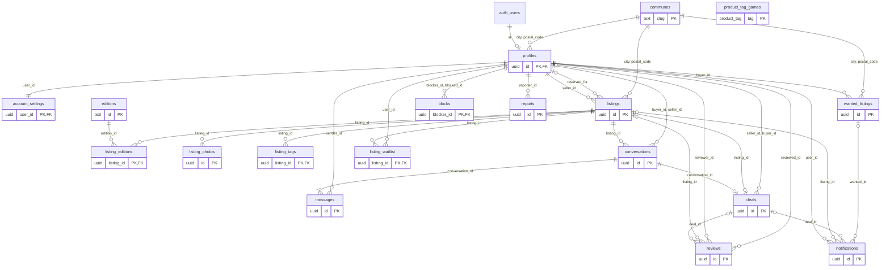

# MLD — Modèle logique des données

Le passage du [MCD](MCD.md) aux relations, indépendamment de PostgreSQL. Les noms sont
déjà ceux de la base (`listings`, `price_cents`) : ce sont eux que le code emploie
(`src/lib/data/rows.ts`), et le [MPD](MPD.md) les reprend tels quels.

## 1. Règles de passage appliquées

1. **Chaque entité devient une relation**, et son identifiant la clé primaire : un UUID
   pour ce que créent les utilisateurs, un code naturel pour les référentiels (le slug
   d'une commune, l'identifiant `pokemon-ev08` d'une série).
2. **Association fonctionnelle** `(x,1)` — `(x,n)` : la relation du côté `(x,1)` reçoit
   la clé étrangère ; non nulle pour `(1,1)`, nullable pour `(0,1)`
   (`listings.reserved_for`, les sujets d'une notification).
3. **`(0,1)` — `(1,1)`** (COMPTE POSSÈDE PROFIL) : la clé primaire est partagée,
   `profiles.id` est l'identifiant du compte d'authentification.
4. **Association non fonctionnelle** : une relation dont la clé concatène celles des
   pattes, avec ses données portées — `listing_editions` (rang), `listing_tags`,
   `product_tag_games`, `listing_waitlist` (inscrit le), `blocks` (bloqué le).
5. **Partition** (SIGNALEMENT VISE l'une de quatre entités) : un type de cible et un
   identifiant, sans clé étrangère — le signalement doit survivre à la disparition de ce
   qu'il vise, et la modération garder la trace.
6. **Fragmentation verticale** du PROFIL : ses deux réglages d'alerte, privés, passent
   dans `account_settings` (1–1). Le profil se lit en entier par n'importe qui ; une
   ligne ne se lit pas à moitié.
7. **Clés étrangères vers une clé candidate** : les annonces, demandes et profils visent
   une commune par le couple `(city, postal_code)`, unique dans `communes`. C'est le
   couple que les formulaires envoient et que l'interface affiche ; le slug sert aux URL.

## 2. Notation

`relation (**#clé_primaire**, attribut, #clé_étrangère → relation visée)`

* **en gras** : la clé primaire (soulignée en notation Merise), précédée de `#` ;
* `#attribut → relation` : clé étrangère, suivie de la relation qu'elle vise ; un couple
  entre parenthèses est une clé étrangère composée ;
* `attribut?` : nullable ; `attribut*` : dérivé, maintenu par la base (§ 5) ;
* `UNIQUE (…)` : clé candidate.

## 3. Relations

### Comptes et profils

* **auth.users** (**#id**, email, …) — COMPTE, tenu par Supabase Auth.
* **profiles** (**#id** → auth.users, username, #(city, postal_code) → communes,
  avatar_initials, bio?, account_type, company_name?, siret?, legal_name?,
  pro_verified_at?, shop_address?, shop_hours?, shop_website?, cardmarket_url?,
  cardnexus_url?, pro_until?, sold_listing_count, rating_avg?\*,
  rating_count\*, punctuality_avg?\*, responsiveness_avg?\*, reliability_avg?\*,
  created_at) — UNIQUE (username).
* **account_settings** (**#user_id** → profiles, alert_matches, alert_messages,
  updated_at).

### Référentiels

* **games** (**#id**, label, sort_order) — JEU ; type énuméré `game_id` au MPD.
* **product_tags** (**#id**, label) — PRODUIT ; type énuméré `product_tag` au MPD.
* **product_tag_games** (**#tag** → product_tags, **#game_id** → games) — EXISTE POUR.
* **editions** (**#id**, #game_id → games, code, name, year, block, sort_order) — SÉRIE ;
  UNIQUE (game_id, code), UNIQUE (game_id, sort_order).
* **departments** (**#code**, name) — DÉPARTEMENT ; replié dans `communes` au MPD.
* **communes** (**#slug**, name, postal_code, #department_code → departments,
  department_name\*, latitude, longitude) — UNIQUE (name, postal_code).

### Annonces

* **listings** (**#id**, slug, #seller_id → profiles, #game_id → games, title,
  description, lot_type, card_count?, weight_kg?, condition, language, price_cents,
  previous_price_cents?, #(city, postal_code) → communes, department_code\*,
  latitude\*, longitude\*, status, #reserved_for? → profiles, audience, open_to_trade,
  trade_note?, featured_until?, urgent_until?, extra_photos, bump_started_at?,
  bump_until?, renewed_at, view_count, created_at,
  updated_at, sold_at?) — UNIQUE (slug).
* **photo_uploads** (**#key**, #owner_id? → profiles, created_at, detached_at?,
  purge_started_at?) — le registre technique des fichiers déposés chez Cloudflare Images,
  écrit par le serveur seul ; les deux dates servent le ménage.
* **listing_photos** (**#id**, #listing_id → listings, #storage_path → photo_uploads,
  position) — UNIQUE (listing_id, position), UNIQUE (storage_path) : un fichier, une photo.
* **photo_purge_lease** (**singleton**, run_id, expires_at) — une ligne au plus : le passage
  du ménage en cours, technique comme le registre.
* **listing_editions** (**#listing_id** → listings, **#edition_id** → editions,
  position) — COUVRE ; UNIQUE (listing_id, position).
* **listing_tags** (**#listing_id** → listings, **#tag** → product_tags) — CONTIENT.

### Demandes de recherche

* **wanted_listings** (**#id**, slug, #buyer_id → profiles, #game_id → games, title,
  description, lot_type?, max_price_cents?, min_card_count?, #(city, postal_code) →
  communes, department_code\*, latitude\*, longitude\*, max_distance_km, status,
  created_at, updated_at, fulfilled_at?) — UNIQUE (slug).

### Messagerie

* **conversations** (**#id**, #listing_id → listings, #buyer_id → profiles,
  #seller_id → profiles, created_at, last_message_at\*, buyer_deleted_at?,
  seller_deleted_at?) — UNIQUE (listing_id, buyer_id).
* **messages** (**#id**, #conversation_id → conversations, #sender_id → profiles, body,
  read_at?, created_at).

### Ventes et avis

* **deals** (**#id**, #conversation_id → conversations, #listing_id\* → listings,
  #seller_id\* → profiles, #buyer_id\* → profiles, kind, closed_at) —
  UNIQUE (conversation_id), UNIQUE (listing_id).
* **reviews** (**#id**, #deal_id? → deals, #listing_id?\* → listings,
  #reviewer_id? → profiles, #reviewed_id\* → profiles, reviewed_role\*, punctuality,
  responsiveness, reliability, comment?, created_at) — UNIQUE (deal_id, reviewer_id).
  Les trois premières clés sont nullables : l'avis survit au compte de son auteur et à
  la vente qui part avec lui.

### Liste d'attente et notifications

* **listing_waitlist** (**#listing_id** → listings, **#user_id** → profiles,
  created_at) — ATTEND.
* **notifications** (**#id**, #user_id → profiles, kind, #listing_id? → listings,
  #deal_id? → deals, #wanted_id? → wanted_listings, created_at, read_at?).

### Modération

* **blocks** (**#blocker_id** → profiles, **#blocked_id** → profiles, created_at) —
  BLOQUE.
* **reports** (**#id**, #reporter_id → profiles, target_type, target_id, reason,
  details?, created_at, resolved_at?) — UNIQUE (reporter_id, target_type, target_id).

## 4. Diagramme logique

Les relations physiques et leurs clés (les attributs non clés sont au MPD). `games`,
`product_tags` et `departments` n'y figurent pas : au MPD, ce sont un type énuméré et
deux colonnes de `communes`.

`product_tag_games` n'a pas de lien dessiné : ses deux colonnes sont des types énumérés
au MPD. `reports` vise sa cible par `(target_type, target_id)`, sans clé étrangère.

## 5. Normalisation

Les relations sont en troisième forme normale, à des écarts près, voulus et tenus par la
base elle-même — jamais par l'application, qui ne peut pas les écrire :

| Attribut dérivé | Dérivé de | Maintenu par | Pourquoi le stocker |
|---|---|---|---|
| `profiles.rating_avg`, `rating_count`, `punctuality_avg`, `responsiveness_avg`, `reliability_avg` | `reviews` | `refresh_rating` | la note s'affiche sur chaque vignette ; une agrégation par vendeur affiché à chaque rendu. Absente sans avis, jamais 0 |
| `profiles.avatar_initials` | `username` | l'écriture du profil | lu partout où le vendeur apparaît |
| `listings` et `wanted_listings` : `department_code`, `latitude`, `longitude` | `communes` | `stamp_commune` | la copie est figée à la publication : un import du référentiel ne déplace pas une annonce. La distance se calcule sans jointure |
| `communes.department_name` | le département | l'import du référentiel | référentiel en lecture seule : aucune anomalie de mise à jour possible |
| `conversations.last_message_at` | `messages` | `touch_conversation` | tri de la boîte de réception sans agrégation |
| `deals.listing_id`, `seller_id`, `buyer_id` | `conversations` | `close_deal` | la politique « vente lue par ses parties », l'unicité « un lot ne se vend qu'une fois », les listes « Ventes et achats » |
| `reviews.listing_id`, `reviewed_id`, `reviewed_role` | `deals` et l'auteur | `stamp_review` | la personne notée doit rester connue quand la vente disparaît avec un compte supprimé |

`profiles.sold_listing_count` n'est pas un dérivé : c'est un historique. Une annonce
vendue puis supprimée reste une vente du compte, et l'écart avec la liste affichée est
écrit en clair (`src/app/mon-compte/page.tsx`).

Les listes d'une annonce — séries, produits, photos — sont des relations et non des
tableaux dans une colonne : c'est ce qui permet de filtrer (« EV08 »), de compter les
facettes et de contraindre chaque élément.

## 6. Des entités au physique

| MCD | MLD | MPD |
|---|---|---|
| COMPTE | `auth.users` | table de Supabase Auth, hors migrations |
| PROFIL | `profiles` + `account_settings` | deux tables, clé partagée |
| JEU | `games` | type énuméré `game_id`, dans l'ordre de `GAME_IDS` |
| PRODUIT | `product_tags` | type énuméré `product_tag` |
| EXISTE POUR | `product_tag_games` | table remplie par la migration |
| SÉRIE | `editions` | 98 lignes posées par la migration, le reste par `npm run supabase:editions` |
| DÉPARTEMENT | `departments` | colonnes `department_code`, `department_name` de `communes` |
| COMMUNE | `communes` | 112 lignes posées par la migration, le reste par `npm run supabase:communes` |
| les autres entités et associations | une relation chacune | une table chacune |

Pourquoi un type énuméré pour JEU et PRODUIT : ni l'un ni l'autre n'a de propriété propre
en base — les libellés vivent dans `src/lib/labels.ts`, seul endroit où les valeurs
deviennent françaises, et les couleurs dans `styles/tokens.css`. `GAME_IDS` est la seule
liste des jeux du projet (`CLAUDE.md`, règle 9) : une table `games` en serait une copie
de plus. L'énumération garde l'ordre d'affichage (`order by game_id`), et
`tests/schema-sync.test.mjs` la compare à `GAME_IDS`. `src/lib/data/games.ts` reste donc
dérivé de la liste du code en phase 2 (au besoin, `enum_range(null::game_id)` rend la même).
