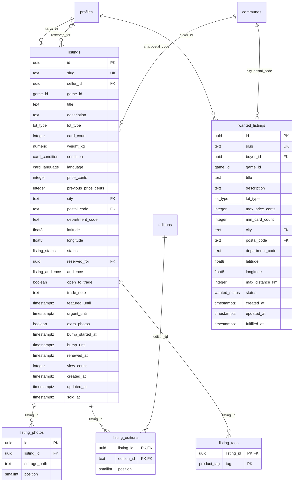

# MPD — Annonces et demandes

Partie du [MPD](MPD.md). Migrations `20260929120300_listings.sql` et
`20260929120400_wanted.sql`. Les tableaux de colonnes sont produits à partir des
migrations.

## `listings` — les annonces

Le lot mis en vente. Lecture selon l'audience (voir [sécurité](MPD-securite.md)) : une
annonce vendue reste servie — son lien a été partagé —, une annonce réservée aux pros ne
l'est qu'à son vendeur et aux pros au forfait actif.

| Colonne | Type | Nul | Défaut | Contrainte | Rôle |
|---|---|---|---|---|---|
| `id` | `uuid` | non | `gen_random_uuid()` | clé primaire | identifiant |
| `slug` | `text` | non |  | unique ; `check (slug ~ '^[a-z0-9]+(-[a-z0-9]+)*$')` | lien permanent, jamais réécrit |
| `seller_id` | `uuid` | non |  | → `profiles`, *on delete cascade* | le vendeur |
| `game_id` | `game_id` | non |  |  | le jeu |
| `title` | `text` | non |  | `check (char_length(title) between 12 and 90)` | titre |
| `description` | `text` | non |  | `check (char_length(description) between 40 and 4000)` | description |
| `lot_type` | `lot_type` | non |  |  | format de lot |
| `card_count` | `integer` | oui |  | `check (card_count is null or card_count > 0)` | absent = non compté |
| `weight_kg` | `numeric(6, 2)` | oui |  | `check (weight_kg is null or weight_kg > 0)` | absent = non pesé |
| `condition` | `card_condition` | non |  |  | état |
| `language` | `card_language` | non |  |  | langue |
| `price_cents` | `integer` | non |  | `check (price_cents > 0 and price_cents <= 500000)` | prix, au plus 5 000 € |
| `previous_price_cents` | `integer` | oui |  | `check (previous_price_cents is null or previous_price_cents > 0)` | prix d'avant une baisse |
| `city` | `text` | non |  |  | commune du rendez-vous |
| `postal_code` | `text` | non |  | `check (postal_code ~ '^\d{5}$')` | son code postal |
| `department_code` | `text` | non |  |  | recopié de la commune — `stamp_commune` |
| `latitude` | `double precision` | non |  | `check (latitude between -90 and 90)` | recopiée de la commune — `stamp_commune` |
| `longitude` | `double precision` | non |  | `check (longitude between -180 and 180)` | recopiée de la commune — `stamp_commune` |
| `status` | `listing_status` | non | `'available'` |  | disponible, réservé, vendu |
| `reserved_for` | `uuid` | oui |  | → `profiles`, *on delete set null* | pour qui le lot est réservé — `reserve_listing` |
| `audience` | `listing_audience` | non | `'everyone'` |  | tout le monde, ou les pros |
| `open_to_trade` | `boolean` | non | `false` |  | ouvert à l'échange |
| `trade_note` | `text` | oui |  | `check (trade_note is null or char_length(trade_note) between 1 and 140)` | contre quoi |
| `featured_until` | `timestamptz` | oui |  |  | fin de « À la une » ; écrite par le paiement |
| `urgent_until` | `timestamptz` | oui |  |  | fin de « Urgent » ; écrite par le paiement |
| `extra_photos` | `boolean` | non | `false` |  | option « 8 photos » ; écrite par le paiement |
| `bump_started_at` | `timestamptz` | oui |  | `listings_bump_window` | début de « Remonter » ; écrit par le paiement (migration 15) |
| `bump_until` | `timestamptz` | oui |  | `listings_bump_window` | fin de « Remonter » ; une remontée par jour entre les deux — `getRankedAt` |
| `renewed_at` | `timestamptz` | non | `now()` |  | dernier geste du vendeur ; l'annonce expire 90 jours plus tard — `listings_renew_on_activity`, `renew_listing` (migration 15) |
| `view_count` | `integer` | non | `0` | `check (view_count >= 0)` | vues — `record_listing_view` |
| `created_at` | `timestamptz` | non | `now()` |  | dépôt |
| `updated_at` | `timestamptz` | non | `now()` |  | modification (pas une vue) — `set_updated_at` |
| `sold_at` | `timestamptz` | oui |  |  | passage en « Vendu » |

Contraintes de table :

* `constraint listings_sold_at_matches_status check ((status = 'sold') = (sold_at is not null))`
* `constraint listings_reserved_for_matches_status check (reserved_for is null or status = 'reserved')`
* `constraint listings_trade_note_needs_trade check (trade_note is null or open_to_trade)`
* `constraint listings_previous_price_above_price check (previous_price_cents is null or previous_price_cents > price_cents)`
* `constraint listings_commune_fkey foreign key (city, postal_code) references public.communes (name, postal_code)`
* `constraint listings_bump_window check ((bump_started_at is null) = (bump_until is null) and (bump_until is null or bump_until > bump_started_at))` (migration 15)

Qui écrit quoi : le vendeur écrit les colonnes de `ListingInsert` et `ListingUpdate`
(`src/lib/data/rows.ts`), jamais `featured_until`, `urgent_until`, `extra_photos`,
`bump_started_at`, `bump_until`, `renewed_at`, `view_count` ni `reserved_for`. Les quatre
options sont écrites par le service de paiement ; `renewed_at` par la base, à chaque geste
du vendeur (`listings_renew_on_activity`) et par `renew_listing` ; `view_count` par `record_listing_view`, appelée par le serveur avec la clé de
service ; `reserved_for` par `reserve_listing`. Le département et les coordonnées que le
navigateur envoie sont remplacés par ceux de la commune (`stamp_commune`).

Index :

| Index | Colonnes | Sert |
|---|---|---|
| `listings_public_feed` | `(status, created_at desc)` | la liste publique, les plus récentes d'abord |
| `listings_by_game` | `(game_id, status, created_at desc)` | les pages de jeu |
| `listings_by_seller` | `(seller_id, created_at desc)` | le profil et « Mes annonces » |
| `listings_by_position` | `(latitude, longitude)` | la boîte englobante de `listings_within` |
| `listings_featured` | `(featured_until)` partiel | la section « À la une » |
| `listings_pros_feed` | `(created_at desc)` partiel, `audience = 'pros'` | l'espace pro |
| `listings_by_reserved_for` | `(reserved_for)` partiel | la remise à null quand un compte disparaît |
| `listings_by_renewal` | `(renewed_at)` partiel, `status <> 'sold'` | la tâche quotidienne : les échéances proches et passées |
| `listings_by_sale` | `(sold_at)` partiel, `status = 'sold'` | la tâche quotidienne : les ventes à archiver |

Déclencheurs (détail dans [les règles](MPD-regles.md)) ; PostgreSQL déclenche ceux d'un
même moment par ordre alphabétique. Avant l'écriture : `listings_clear_reservation`,
`listings_freeze_after_deal`, `listings_game_change`, `listings_keep_closed_deal_sold`, `listings_renew_on_activity`,
`listings_stamp_commune`, `listings_updated_at` (sauf pour une vue comptée). Après la mise à jour du statut :
`listings_count_sale`, puis `listings_notify_waitlist`.

## `photo_uploads` — le registre des fichiers

Les fichiers photo vivent chez Cloudflare Images, pas dans la base. Le serveur
inscrit ici chaque fichier au moment où il délivre l'adresse de dépôt, avec la clé de
service : c'est la seule preuve qu'une image appartient à un compte. Un préfixe de chemin
ne peut pas la porter — Cloudflare Images tire lui-même l'identifiant d'une image privée,
et les photos d'un lot réservé aux pros doivent l'être. Le registre sert aussi le ménage :
les cascades n'atteignent pas Cloudflare.

| Colonne | Type | Nul | Défaut | Contrainte | Rôle |
|---|---|---|---|---|---|
| `key` | `text` | non |  | clé primaire ; lettres, chiffres, `._/-`, jamais `..`, 255 au plus | l'identifiant Cloudflare Images — jamais une URL ; remplacé par le serveur si Cloudflare en rend un autre au changement de visibilité |
| `owner_id` | `uuid` | oui |  | → `profiles`, *on delete set null* | le compte qui l'a téléversé ; nul une fois ce compte supprimé, le temps du ménage |
| `created_at` | `timestamptz` | non | `now()` |  | le délai de grâce d'un fichier jamais accroché part d'ici (7 jours) |
| `detached_at` | `timestamptz` | oui |  | posée et effacée par `listing_photos_track_upload` | quand la dernière photo qui l'affichait est partie ; le délai d'un fichier décroché part d'ici (1 jour) ; nulle tant qu'une photo l'affiche, ou s'il n'a jamais été accroché |
| `purge_started_at` | `timestamptz` | oui |  | posée par `claim_photo_purge` | le ménage l'a pris : plus aucune photo ne l'accroche, et la ligne part quand Cloudflare a confirmé le retrait (`forget_purged_photos`) ; reposée à chaque reprise, une heure au moins après la précédente |

Écrit par la clé de service seule ; chacun lit ses propres lignes, un anonyme aucune
([sécurité](MPD-securite.md)). Le ménage quotidien retire chez Cloudflare, puis ici, les
lignes qu'aucune photo n'affiche plus : dépôt abandonné, photos 4 à 8 dont le paiement
n'est pas venu, photo retirée, annonce ou compte supprimés. `claim_photo_purge()` les
rend par lots de 1 à 1 000, passé leur délai de grâce — ceux de `src/lib/photo-hosting.ts`
—, marquées, et rend de nouveau, une heure plus tard et en tête du lot, celles dont le
retrait n'a pas abouti ; `forget_purged_photos()` efface les lignes des fichiers partis
([règles](MPD-regles.md)).

## `photo_purge_lease` — le bail du ménage

Une ligne au plus : le passage du ménage en cours. Deux passages doubleraient le débit
envoyé à Cloudflare, dont la limite bloque alors tout le compte cinq minutes — dépôts des
vendeurs compris —, et Vercel Cron livre parfois deux fois la même échéance.

| Colonne | Type | Nul | Défaut | Contrainte | Rôle |
|---|---|---|---|---|---|
| `singleton` | `boolean` | non | `true` | clé primaire, `check (singleton)` | une seule ligne possible |
| `run_id` | `uuid` | non |  |  | le passage qui tient le bail, tiré au hasard par le serveur |
| `expires_at` | `timestamptz` | non |  |  | cinq minutes après sa prise, au-delà de la vie d'une fonction de Vercel : un passage tué ne retient le ménage que jusque-là |

Pris par le premier lot d'un passage (`claim_photo_purge`), qui refuse tout autre passage
tant qu'il court ; rendu à la fin (`release_photo_purge`). Aucun rôle de l'API n'y lit ni
n'y écrit ([sécurité](MPD-securite.md)).

## `retired_slugs` — les liens qui ont servi

Un lien permanent ne désigne jamais une autre annonce (migration 11). Le navigateur choisit
maintenant l'identifiant d'un dépôt — c'est ce qui rend un double envoi inoffensif —, donc
aussi son lien : sans cette table, l'annonce supprimée, un autre vendeur reprenait son lien
exact, et le lien partagé dans un groupe montrait son annonce à lui.

| Colonne | Type | Nul | Défaut | Contrainte | Rôle |
|---|---|---|---|---|---|
| `kind` | `text` | non |  | `check (kind in ('listing', 'wanted'))`, clé primaire avec `slug` | une annonce et une demande peuvent porter le même lien |
| `slug` | `text` | non |  | clé primaire avec `kind` | le lien retiré |
| `retired_at` | `timestamptz` | non | `now()` |  | le moment où l'annonce ou la demande est partie |

Remplie par `retire_slug` à chaque suppression — par le vendeur, ou avec son compte —, et
lue par `check_permalink` au dépôt, qui refuse aussi un lien qui ne finit pas par les huit
premiers caractères de l'identifiant (`idSlugSuffix`, `src/lib/slug.ts`). La règle tient le
navigateur ; le serveur — clé de service, données de démonstration — choisit ses liens.
Aucun rôle de l'API n'y lit ni n'y écrit ; `is_retired_slug` répond seulement si un lien a
servi ([sécurité](MPD-securite.md)).

## `listing_photos`

Jusqu'à huit photos par annonce, trois sans l'option. La ligne ne porte que la clé du
fichier, prise au registre. Pas de ligne sans fichier : elle ferait annoncer « 4 photos »
sur une vignette qui n'en montre aucune.

| Colonne | Type | Nul | Défaut | Contrainte | Rôle |
|---|---|---|---|---|---|
| `id` | `uuid` | non | `gen_random_uuid()` | clé primaire | identifiant ; la graine du motif d'attente en dérive |
| `listing_id` | `uuid` | non |  | → `listings`, *on delete cascade* | l'annonce |
| `storage_path` | `text` | non |  | → `photo_uploads (key)`, *on delete restrict*, *on update cascade* | le fichier ; le ménage ne peut pas retirer un fichier encore affiché, et une clé remplacée au registre suit ici |
| `position` | `smallint` | non |  | `check (position between 0 and 7)` | rang, de 0 à 7 |

Contraintes de table :

* `unique (listing_id, position)`
* `listing_photos_one_photo_per_file` : `unique (storage_path)` — un fichier n'affiche
  qu'une photo, d'une seule annonce. La clé que Cloudflare rend en changeant la
  visibilité d'un fichier ne touche donc qu'une annonce : partagé avec une annonce vendue,
  que rien ne modifie plus, le fichier refuserait sa nouvelle clé, et Cloudflare et la
  base se contrediraient. La modification retire les photos avant de les réinsérer. Son
  index sert aussi le ménage et le contrôle de la clé étrangère.

Déclencheurs : `listing_photos_allowance` (`check_photo_allowance`) refuse le rang 3 et
au-delà sans l'option ; `listing_photos_check_upload` (`check_photo_upload`) refuse,
pour tous les rôles — clé de service comprise —, un fichier qui n'est pas un
téléversement du vendeur de l'annonce, et un fichier que le ménage a pris ;
`listing_photos_track_upload` date au registre le moment où plus aucune photo n'affiche
un fichier. La politique d'écriture exige en plus, sous la session, que le fichier soit un
téléversement du vendeur lui-même.

## `listing_editions` — COUVRE

Les séries d'une annonce, dans l'ordre de saisie, douze au plus. Un carton non trié n'en
déclare aucune, et c'est une réponse (« — Non précisé par le vendeur »).

| Colonne | Type | Nul | Défaut | Contrainte | Rôle |
|---|---|---|---|---|---|
| `listing_id` | `uuid` | non |  | → `listings`, *on delete cascade* | l'annonce |
| `edition_id` | `text` | non |  | → `editions` | la série |
| `position` | `smallint` | non |  | `check (position between 0 and 11)` | rang de saisie, de 0 à 11 |

Contraintes de table :

* `primary key (listing_id, edition_id)`
* `unique (listing_id, position)`

Index : `listing_editions_by_edition (edition_id)`, pour le filtre par série et ses
facettes. Déclencheur : `listing_editions_match_game` (`check_listing_edition`) refuse une
série d'un autre jeu que celui de l'annonce.

## `listing_tags` — CONTIENT

Les produits qui partent avec les cartes.

| Colonne | Type | Nul | Défaut | Contrainte | Rôle |
|---|---|---|---|---|---|
| `listing_id` | `uuid` | non |  | → `listings`, *on delete cascade* | l'annonce |
| `tag` | `product_tag` | non |  |  | le produit |

Contraintes de table :

* `primary key (listing_id, tag)`

Index : `listing_tags_by_tag (tag)`. Déclencheur : `listing_tags_match_game`
(`check_listing_tag`) refuse un produit qui n'existe pas pour le jeu de l'annonce
(`product_tag_games`).

## `wanted_listings` — les demandes de recherche

L'annonce vue de l'autre côté, volontairement plus pauvre : ni photo, ni état, ni prix
ferme. Lecture publique, closes comprises : une demande fermée garde son lien, et
disparaît seulement des listes, qui filtrent sur le statut.

| Colonne | Type | Nul | Défaut | Contrainte | Rôle |
|---|---|---|---|---|---|
| `id` | `uuid` | non | `gen_random_uuid()` | clé primaire | identifiant |
| `slug` | `text` | non |  | unique ; `check (slug ~ '^[a-z0-9]+(-[a-z0-9]+)*$')` | lien permanent |
| `buyer_id` | `uuid` | non |  | → `profiles`, *on delete cascade* | l'acheteur |
| `game_id` | `game_id` | non |  |  | le jeu cherché |
| `title` | `text` | non |  | `check (char_length(title) between 12 and 90)` | titre |
| `description` | `text` | non |  | `check (char_length(description) between 30 and 2000)` | description |
| `lot_type` | `lot_type` | oui |  |  | absent = tout format |
| `max_price_cents` | `integer` | oui |  | `check (max_price_cents is null or max_price_cents > 0)` | absent = pas de budget annoncé |
| `min_card_count` | `integer` | oui |  | `check (min_card_count is null or min_card_count > 0)` | absent = tout volume |
| `city` | `text` | non |  |  | point de départ de l'acheteur |
| `postal_code` | `text` | non |  | `check (postal_code ~ '^\d{5}$')` | son code postal |
| `department_code` | `text` | non |  |  | recopié de la commune — `stamp_commune` |
| `latitude` | `double precision` | non |  | `check (latitude between -90 and 90)` | recopiée de la commune — `stamp_commune` |
| `longitude` | `double precision` | non |  | `check (longitude between -180 and 180)` | recopiée de la commune — `stamp_commune` |
| `max_distance_km` | `integer` | non |  | `check (max_distance_km between 5 and 200)` | rayon accepté, qui décide du croisement |
| `status` | `wanted_status` | non | `'open'` |  | en recherche, trouvé, abandonnée |
| `created_at` | `timestamptz` | non | `now()` |  | dépôt |
| `updated_at` | `timestamptz` | non | `now()` |  | modification — `set_updated_at` |
| `fulfilled_at` | `timestamptz` | oui |  |  | « Trouvé » est daté |

Contraintes de table :

* `constraint wanted_fulfilled_at_matches_status check ((status = 'fulfilled') = (fulfilled_at is not null))`
* `constraint wanted_commune_fkey foreign key (city, postal_code) references public.communes (name, postal_code)`

Qui écrit quoi : l'acheteur, colonnes de `WantedInsert` et `WantedUpdate` ; ni `slug`,
ni `buyer_id`, ni les horodatages de création et de modification. Le département et les
coordonnées viennent de la commune (`wanted_stamp_commune`).

Index : `wanted_open_by_game (status, game_id, created_at desc)` pour `/recherches` et les
pages de jeu, `wanted_by_buyer (buyer_id, created_at desc)` pour « Mes recherches ».
Déclencheurs : `wanted_updated_at`, `wanted_stamp_commune`.

## Lectures servies par la base

| Fonction | Rend | Sécurité | Lecture remplacée |
|---|---|---|---|
| `listings_within(origin_lat, origin_lon, radius_km)` | les annonces non vendues du rayon, les plus proches d'abord | invoker : la RLS des annonces s'applique | `getListings({ origin, maxDistanceKm })` |
| `pro_only_count_by_game()` | `(game_id, listing_count)` des annonces réservées aux pros non vendues | definer : un nombre par jeu, jamais une ligne | `getProOnlyCountByGame` |
| `wanted_reaching(origin_lat, origin_lon)` | les demandes ouvertes dont le rayon couvre le point | invoker | `getWantedListings({ reachableOnly })` |

La recherche textuelle (`?q=`), les facettes par série et par produit, et le tri
« les plus proches » s'écrivent en requêtes sur ces tables ; aucun index plein texte
n'est posé tant que la recherche de la phase 2 n'est pas écrite — elle cherche aussi dans
les noms de séries (`editions.name`) et les libellés de produits, qui vivent dans
`src/lib/labels.ts`.
