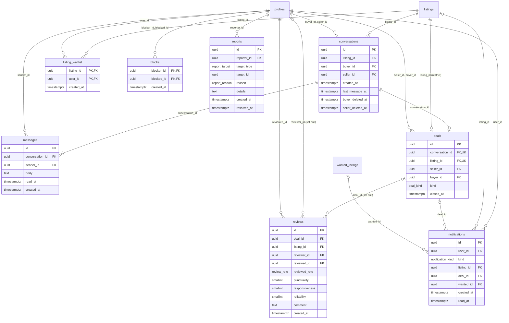

# MPD — Messagerie, ventes, avis, notifications, modération

Partie du [MPD](MPD.md). Migrations `20260929120500_messaging.sql` à
`20260929120800_blocks_reports.sql`. Les tableaux de colonnes sont produits à partir des
migrations.

## `conversations` et `messages`

Une conversation porte toujours sur un lot, entre son vendeur et un acheteur, et naît
avec son premier message. Visible de ses deux participants seulement.

| Colonne | Type | Nul | Défaut | Contrainte | Rôle |
|---|---|---|---|---|---|
| `id` | `uuid` | non | `gen_random_uuid()` | clé primaire | identifiant |
| `listing_id` | `uuid` | non |  | → `listings`, *on delete cascade* | le lot dont on parle |
| `buyer_id` | `uuid` | non |  | → `profiles`, *on delete cascade* | l'acheteur |
| `seller_id` | `uuid` | non |  | → `profiles`, *on delete cascade* | le vendeur de l'annonce |
| `created_at` | `timestamptz` | non | `now()` |  | premier message |
| `last_message_at` | `timestamptz` | non | `now()` |  | tri de la boîte — `touch_conversation` |
| `buyer_deleted_at` | `timestamptz` | oui |  |  | retirée de la boîte de l'acheteur — `hide_conversation` |
| `seller_deleted_at` | `timestamptz` | oui |  |  | retirée de la boîte du vendeur — `hide_conversation` |

Contraintes de table :

* `unique (listing_id, buyer_id)`
* `check (buyer_id <> seller_id)`

La politique d'ouverture vérifie que `seller_id` est bien le vendeur de l'annonce, que le
lot est disponible, que personne n'a bloqué personne, et — quand le vendeur écrit le
premier, pour proposer son lot à une demande — que l'acheteur a une demande ouverte sur
ce jeu. Aucune mise à jour directe : `hide_conversation` pose la date de retrait de
l'appelant, `touch_conversation` la date du dernier message.

Index : `conversations_by_buyer (buyer_id, last_message_at desc)`,
`conversations_by_seller (seller_id, last_message_at desc)` — la boîte de chacun.

| Colonne | Type | Nul | Défaut | Contrainte | Rôle |
|---|---|---|---|---|---|
| `id` | `uuid` | non | `gen_random_uuid()` | clé primaire | identifiant |
| `conversation_id` | `uuid` | non |  | → `conversations`, *on delete cascade* | le fil |
| `sender_id` | `uuid` | non |  | → `profiles`, *on delete cascade* | l'expéditeur |
| `body` | `text` | non |  | `check (char_length(body) between 2 and 2000)` | le texte |
| `read_at` | `timestamptz` | oui |  |  | lu par le destinataire |
| `created_at` | `timestamptz` | non | `now()` |  | envoi |

Un message ne se modifie pas ; son destinataire ne pose que `read_at`. Index :
`messages_by_conversation (conversation_id, created_at)` pour le fil,
`messages_unread (conversation_id)` partiel sur `read_at is null` pour les compteurs,
`messages_by_sender (sender_id)` pour la suppression d'un compte. Déclencheur :
`messages_touch_conversation`.

## `deals` — la vente clôturée

Écrite par `close_deal` seulement, à partir de la conversation : le vendeur ne désigne que
la conversation et la nature de l'accord. Lue par ses deux parties.

| Colonne | Type | Nul | Défaut | Contrainte | Rôle |
|---|---|---|---|---|---|
| `id` | `uuid` | non | `gen_random_uuid()` | clé primaire | identifiant |
| `conversation_id` | `uuid` | non |  | unique ; → `conversations`, *on delete cascade* | la conversation conclue |
| `listing_id` | `uuid` | non |  | unique ; → `listings`, *on delete restrict* | le lot vendu, une seule fois |
| `seller_id` | `uuid` | non |  | → `profiles`, *on delete cascade* | le vendeur, recopié par `close_deal` |
| `buyer_id` | `uuid` | non |  | → `profiles`, *on delete cascade* | l'acheteur, recopié par `close_deal` |
| `kind` | `deal_kind` | non |  |  | vente ou échange |
| `closed_at` | `timestamptz` | non | `now()` |  | clôture |

Contraintes de table :

* `check (seller_id <> buyer_id)`

`listing_id … on delete restrict` : une annonce qui porte une vente ne se supprime pas —
un vendeur mal noté effacerait l'avis. La suppression d'un compte passe quand même :
PostgreSQL applique d'abord toutes les cascades de premier niveau, dont celle de
`deals.seller_id`, et la restriction, vérifiée ensuite sur l'annonce, ne trouve plus de
vente. Les deux comportements ont été rejoués contre la base (voir [MPD](MPD.md), § 8).

Index : `deals_by_seller (seller_id, closed_at desc)`, `deals_by_buyer (buyer_id,
closed_at desc)` — « Ventes et achats ».

## `reviews` — les avis

Un avis par partie et par vente, trois critères de 1 à 5. Le navigateur n'écrit que
`deal_id`, `reviewer_id`, les trois notes et le commentaire ; `stamp_review` pose la
personne notée, son rôle et l'annonce. Un avis ne se modifie pas.

| Colonne | Type | Nul | Défaut | Contrainte | Rôle |
|---|---|---|---|---|---|
| `id` | `uuid` | non | `gen_random_uuid()` | clé primaire | identifiant |
| `deal_id` | `uuid` | oui |  | → `deals`, *on delete set null* | la vente ; nulle si elle a disparu avec un compte |
| `listing_id` | `uuid` | oui |  | → `listings`, *on delete set null* | posée par `stamp_review` ; nulle si l'annonce a disparu |
| `reviewer_id` | `uuid` | oui |  | → `profiles`, *on delete set null* | l'auteur ; nul s'il a supprimé son compte |
| `reviewed_id` | `uuid` | non |  | → `profiles`, *on delete cascade* | la personne notée — `stamp_review` |
| `reviewed_role` | `review_role` | non |  |  | son rôle dans la vente — `stamp_review` |
| `punctuality` | `smallint` | non |  | `check (punctuality between 1 and 5)` | ponctualité |
| `responsiveness` | `smallint` | non |  | `check (responsiveness between 1 and 5)` | délai de réponse |
| `reliability` | `smallint` | non |  | `check (reliability between 1 and 5)` | fiabilité |
| `comment` | `text` | oui |  | `check (comment is null or char_length(comment) between 1 and 1000)` | commentaire ; absent plutôt que vide |
| `created_at` | `timestamptz` | non | `now()` |  | écriture |

Contraintes de table :

* `unique (deal_id, reviewer_id)`
* `check (reviewer_id <> reviewed_id)`

`deal_id`, `listing_id` et `reviewer_id` passent à null au lieu d'emporter l'avis : un
compte supprimé ne retire pas ce qu'il a écrit sur les autres (« ils leur appartiennent,
pas à vous », `/mon-compte/parametres`). `reviewed_id` suit la personne notée.

Index : `reviews_by_reviewed (reviewed_id, created_at desc)` pour le profil,
`reviews_by_reviewer (reviewer_id)` et `reviews_by_listing (listing_id)` pour les mises à
null. Déclencheurs : `reviews_stamp`, `reviews_refresh_rating`, `reviews_notify`.

## `listing_waitlist` — ATTEND

Les inscrits sur un lot réservé. Chacun ne lit que sa propre inscription ; le vendeur
n'en connaît que le nombre, par `waitlist_count`. La liste se vide dès que le lot quitte
« Réservé » (`notify_waitlist`).

| Colonne | Type | Nul | Défaut | Contrainte | Rôle |
|---|---|---|---|---|---|
| `listing_id` | `uuid` | non |  | → `listings`, *on delete cascade* | le lot réservé attendu |
| `user_id` | `uuid` | non |  | → `profiles`, *on delete cascade* | qui attend |
| `created_at` | `timestamptz` | non | `now()` |  | inscription |

Contraintes de table :

* `primary key (listing_id, user_id)`

Index : `listing_waitlist_by_user (user_id)`.

## `notifications`

Quatre sortes, chacune avec sa source en base : `notify_waitlist` (lot de nouveau
disponible), `close_deal` (vente clôturée), `notify_review` (avis reçu), et le dépôt d'une
annonce, qui écrit les croisements avec la clé de service. Aucune ne s'écrit depuis le
navigateur ; le destinataire ne modifie que `read_at`.

| Colonne | Type | Nul | Défaut | Contrainte | Rôle |
|---|---|---|---|---|---|
| `id` | `uuid` | non | `gen_random_uuid()` | clé primaire | identifiant |
| `user_id` | `uuid` | non |  | → `profiles`, *on delete cascade* | le destinataire |
| `kind` | `notification_kind` | non |  |  | sorte |
| `listing_id` | `uuid` | oui |  | → `listings`, *on delete cascade* | le lot dont elle parle |
| `deal_id` | `uuid` | oui |  | → `deals`, *on delete cascade* | la vente dont elle parle |
| `wanted_id` | `uuid` | oui |  | → `wanted_listings`, *on delete cascade* | la demande dont elle parle |
| `created_at` | `timestamptz` | non | `now()` |  | création |
| `read_at` | `timestamptz` | oui |  |  | lue — seule colonne modifiable |

Contraintes de table :

* `constraint notifications_listing_available_subject check (kind <> 'listing_available' or listing_id is not null)`
* `constraint notifications_deal_closed_subject check (kind <> 'deal_closed' or (listing_id is not null and deal_id is not null))`
* `constraint notifications_review_received_subject check (kind <> 'review_received' or deal_id is not null)`
* `constraint notifications_wanted_match_subject check (kind <> 'wanted_match' or (listing_id is not null and wanted_id is not null))`
* `constraint notifications_listing_expiring_subject check (kind <> 'listing_expiring' or listing_id is not null)` (migration 15)

Les cinq contraintes de sujet font de la sorte une promesse : une notification mène
toujours quelque part. L'autre personne — le vendeur qui a clôturé, celle qui a noté — se
lit sur la vente ou sur l'avis, pas dans la notification.

Index : `notifications_by_user (user_id, created_at desc)` pour la cloche et la page ;
trois index partiels sur `listing_id`, `deal_id`, `wanted_id` pour les cascades.

## `blocks` — BLOQUE

| Colonne | Type | Nul | Défaut | Contrainte | Rôle |
|---|---|---|---|---|---|
| `blocker_id` | `uuid` | non |  | → `profiles`, *on delete cascade* | qui bloque |
| `blocked_id` | `uuid` | non |  | → `profiles`, *on delete cascade* | qui est bloqué |
| `created_at` | `timestamptz` | non | `now()` |  | blocage |

Contraintes de table :

* `primary key (blocker_id, blocked_id)`
* `check (blocker_id <> blocked_id)`

Chacun ne lit, ne pose et ne lève que ses propres blocages ; le bloqué n'en voit aucun.
`is_blocked_between` regarde les deux sens, pour une paire dont l'appelant fait partie.
Index : `blocks_by_blocked (blocked_id)`.

## `reports` — les signalements

| Colonne | Type | Nul | Défaut | Contrainte | Rôle |
|---|---|---|---|---|---|
| `id` | `uuid` | non | `gen_random_uuid()` | clé primaire | identifiant |
| `reporter_id` | `uuid` | non |  | → `profiles`, *on delete cascade* | qui signale |
| `target_type` | `report_target` | non |  |  | annonce, compte, conversation ou demande |
| `target_id` | `uuid` | non |  |  | l'identifiant de la cible, sans clé étrangère |
| `reason` | `report_reason` | non |  |  | motif |
| `details` | `text` | oui |  | `check (details is null or char_length(details) <= 1000)` | détail ; absent plutôt que vide |
| `created_at` | `timestamptz` | non | `now()` |  | dépôt |
| `resolved_at` | `timestamptz` | oui |  |  | traité par la modération |

Contraintes de table :

* `unique (reporter_id, target_type, target_id)`

La cible est désignée par `(target_type, target_id)` sans clé étrangère : elle peut être
de quatre natures, et le signalement survit à sa disparition. `check_report_target`
(avant insertion) vérifie, sous la RLS de celui qui signale, que la cible existe pour lui
et qu'elle n'est pas à lui. Lecture réservée à la modération (clé `service_role`), qui
seule pose `resolved_at`.
