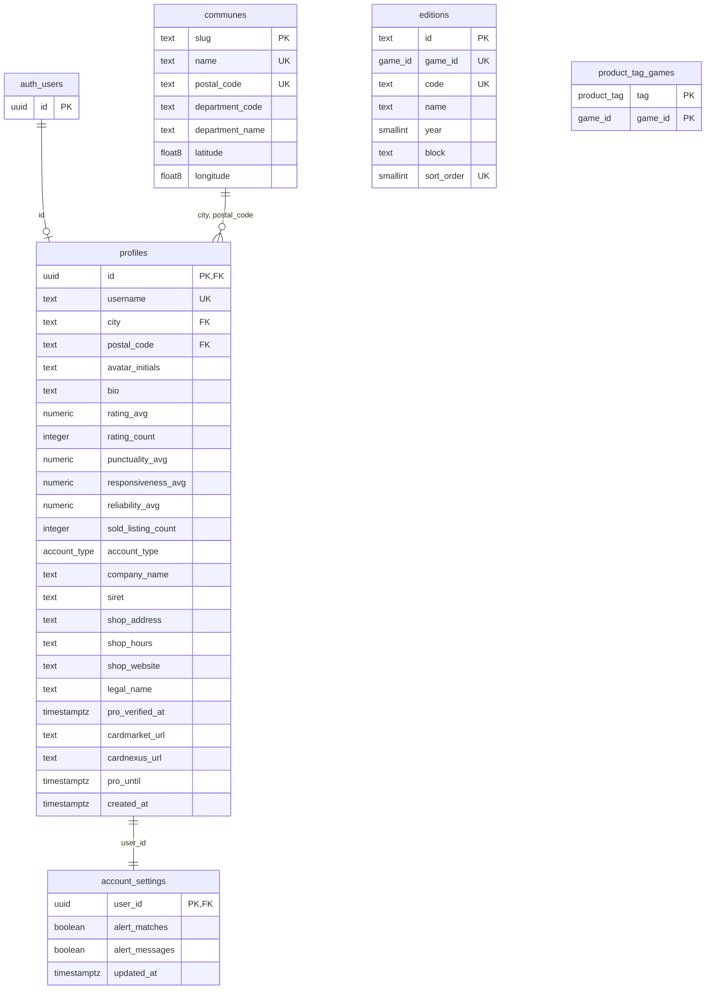

# MPD — Référentiels et profils

Partie du [MPD](MPD.md). Migrations `20260929120100_referentials.sql` et
`20260929120200_profiles.sql`. Les tableaux de colonnes sont produits à partir des
migrations : types, nullabilité, défauts et contrôles y sont ceux de la base.

`editions` et `product_tag_games` ne se référencent pas : elles partagent le type
`game_id`, et c'est par lui que les déclencheurs de la migration 4 les croisent avec le jeu
d'une annonce.

## Référentiels

Trois tables remplies par la migration elle-même, avec les listes du code de la phase 1.
`tests/schema-sync.test.mjs` compare leurs lignes au code : une commune, une série ou un
produit ajouté d'un seul côté fait échouer les tests. Aucun rôle de l'API n'y écrit ; les
imports de la phase 2 (base officielle des communes, Scryfall, TCGdex) passent par la clé
`service_role`. Lecture publique.

### `communes` — 112 lignes, 52 départements

Source : `src/lib/cities.ts` (`CITIES`). Clé primaire `slug` (le segment d'URL des pages
`/[jeu]/[ville]`), clé candidate `(name, postal_code)`, visée par les annonces, les
demandes et les profils. Le département est replié dans la commune (voir
[MLD](MLD.md), § 6) : `department_name` dépend de `department_code`, mais le référentiel
n'est jamais modifié ligne à ligne, il est importé.

| Colonne | Type | Nul | Défaut | Contrainte | Rôle |
|---|---|---|---|---|---|
| `slug` | `text` | non |  | clé primaire ; `check (slug ~ '^[a-z0-9]+(-[a-z0-9]+)*$')` | segment d'URL des pages `/[jeu]/[ville]` |
| `name` | `text` | non |  |  | nom affiché, envoyé par les formulaires |
| `postal_code` | `text` | non |  | `check (postal_code ~ '^\d{5}$')` | code postal de la commune |
| `department_code` | `text` | non |  | `check (department_code ~ '^(\d{2}\|2[AB]\|97\d)$')` | département, pour le filtre et les lots voisins |
| `department_name` | `text` | non |  |  | nom du département (textes des pages de ville) |
| `latitude` | `double precision` | non |  | `check (latitude between -90 and 90)` | centre-ville, pour les distances |
| `longitude` | `double precision` | non |  | `check (longitude between -180 and 180)` | centre-ville, pour les distances |

Contraintes de table :

* `unique (name, postal_code)`

### `editions` — 214 séries

Source : `src/lib/editions/editions.json`, tiré des API de chaque jeu par
`scripts/editions-update.mjs` et chargé par `npm run supabase:editions` (53 Pokémon,
94 Magic, 22 One Piece, 13 Lorcana, 5 Riftbound, 23 Yu-Gi-Oh, 4 Naruto le 1er octobre
2026 ; « Autre » n'en a pas). La migration 2 n'en pose que les 98 de la phase 1, dont
l'identifiant ne change jamais. `sort_order` garde l'ordre du référentiel, jeu par jeu :
c'est l'ordre du formulaire de dépôt, où le bloc entier (« EV », toutes séries) précède les
extensions récentes — l'année ne le rendrait pas. Une série retirée du référentiel reste en
base, en fin d'ordre, pour la clé étrangère des annonces qui la citent.

| Colonne | Type | Nul | Défaut | Contrainte | Rôle |
|---|---|---|---|---|---|
| `id` | `text` | non |  | clé primaire ; `check (id ~ '^[a-z]+-[a-z0-9]+(-[a-z0-9]+)*$')` | `<jeu>-<code>` : l'identifiant porte le jeu |
| `game_id` | `game_id` | non |  |  | le jeu de la série |
| `code` | `text` | non |  |  | ce que les vendeurs écrivent : `EV08`, `MH3`, `OP-09` |
| `name` | `text` | non |  |  | nom affiché et cherché (« Étincelles Déferlantes ») |
| `year` | `smallint` | non |  |  | année, tri des facettes |
| `block` | `text` | non |  |  | regroupement du formulaire de dépôt |
| `sort_order` | `smallint` | non |  | `check (sort_order > 0)` | rang dans le référentiel, par jeu |

Contraintes de table :

* `constraint editions_id_carries_game check (starts_with(id, game_id::text || '-'))`
* `unique (game_id, code)`
* `unique (game_id, sort_order)`

### `product_tag_games` — 78 couples

Source : `src/lib/product-tags.ts`. Neuf produits existent pour les huit jeux (display,
boosters, coffret, deck préconstruit, promo, cartes gradées, tapis, protège-cartes,
classeur fourni) ; les cinq autres sont propres à un ou deux jeux (ETB et UPC chez
Pokémon, boîte métal chez Pokémon et Yu-Gi-Oh, bundle chez Magic, Structure Deck chez
Yu-Gi-Oh).

| Colonne | Type | Nul | Défaut | Contrainte | Rôle |
|---|---|---|---|---|---|
| `tag` | `product_tag` | non |  |  | le produit |
| `game_id` | `game_id` | non |  |  | un jeu pour lequel il existe |

Contraintes de table :

* `primary key (tag, game_id)`

## Profils

### `profiles`

Un profil par compte d'authentification, clé partagée avec `auth.users`. Il naît de
`handle_new_user` à l'inscription par e-mail (le pseudo et la commune viennent des
métadonnées), ou d'un `insert` du titulaire après une connexion Google. Lecture
publique, ligne entière : c'est ce que montrent les vignettes et la page `/profil/[pseudo]`.

| Colonne | Type | Nul | Défaut | Contrainte | Rôle |
|---|---|---|---|---|---|
| `id` | `uuid` | non |  | clé primaire ; → `auth.users`, *on delete cascade* | identifiant du compte d'authentification |
| `username` | `text` | non |  | unique ; `check (username ~ '^[a-z0-9._-]{3,24}$')` | pseudo, dans le filigrane des photos |
| `city` | `text` | non |  |  | commune du compte (avec le code postal) |
| `postal_code` | `text` | non |  | `check (postal_code ~ '^\d{5}$')` | code postal de la commune |
| `avatar_initials` | `text` | non |  |  | deux lettres tirées du pseudo |
| `bio` | `text` | oui |  | `check (bio is null or char_length(bio) <= 280)` | présentation ; absente plutôt que vide |
| `rating_avg` | `numeric(2, 1)` | oui |  | `check (rating_avg is null or rating_avg between 1 and 5)` | moyenne des trois critères — `refresh_rating` |
| `rating_count` | `integer` | non | `0` | `check (rating_count >= 0)` | nombre d'avis reçus — `refresh_rating` |
| `punctuality_avg` | `numeric(2, 1)` | oui |  | `check (punctuality_avg is null or punctuality_avg between 1 and 5)` | ponctualité moyenne — `refresh_rating` |
| `responsiveness_avg` | `numeric(2, 1)` | oui |  | `check (responsiveness_avg is null or responsiveness_avg between 1 and 5)` | délai de réponse moyen — `refresh_rating` |
| `reliability_avg` | `numeric(2, 1)` | oui |  | `check (reliability_avg is null or reliability_avg between 1 and 5)` | fiabilité moyenne — `refresh_rating` |
| `sold_listing_count` | `integer` | non | `0` | `check (sold_listing_count >= 0)` | historique des ventes — `count_sale` |
| `account_type` | `account_type` | non | `'individual'` |  | particulier ou pro ; écrit par le paiement |
| `company_name` | `text` | oui |  | `check (company_name is null or char_length(company_name) between 2 and 80)` | nom de la boutique, si et seulement si pro |
| `siret` | `text` | oui |  | `check (siret is null or siret ~ '^\d{14}$')` | vérifié à la souscription ; écrit par le paiement |
| `shop_address` | `text` | oui |  | `check (shop_address is null or char_length(shop_address) between 5 and 160)` | fiche boutique |
| `shop_hours` | `text` | oui |  | `check (shop_hours is null or char_length(shop_hours) between 3 and 160)` | fiche boutique |
| `shop_website` | `text` | oui |  | `check (shop_website is null or (shop_website ~ '^https://\S+$' and char_length(shop_website) <= 200))` | fiche boutique |
| `legal_name` | `text` | oui |  | `check (legal_name is null or char_length(legal_name) between 1 and 200)` | raison sociale du répertoire, écrite par la vérification du SIRET (migration 16) |
| `pro_verified_at` | `timestamptz` | oui |  |  | date de la vérification du SIRET |
| `cardmarket_url` | `text` | oui |  | adresse d'une page vendeur `https://www.cardmarket.com/<langue>/<jeu>/Users/<pseudo>` | déclarée par la boutique, non vérifiée |
| `cardnexus_url` | `text` | oui |  | `https://(www.)cardnexus.com/…` | déclarée par la boutique, non vérifiée |
| `pro_until` | `timestamptz` | oui |  |  | fin du forfait ; c'est elle qui ouvre les lots réservés, et elle suppose le statut |
| `created_at` | `timestamptz` | non | `now()` |  | inscription |

Contraintes de table :

* `constraint profiles_company_matches_type check ((account_type = 'pro') = (company_name is not null))`
* `constraint profiles_shop_only_for_pros check (account_type = 'pro' or coalesce(siret, shop_address, shop_hours, shop_website) is null)`
* `constraint profiles_pro_details_only_for_pros check (account_type = 'pro' or (legal_name is null and pro_verified_at is null and cardmarket_url is null and cardnexus_url is null))` (migration 16)
* `constraint profiles_plan_needs_pro check (pro_until is null or account_type = 'pro')` (migration 16)
* index unique `profiles_one_account_per_siret (siret) where siret is not null` : un SIRET, un compte (migration 16)
* `constraint profiles_commune_fkey foreign key (city, postal_code) references public.communes (name, postal_code)`

Qui écrit quoi :

| Colonnes | Écrites par |
|---|---|
| `username`, `city`, `postal_code`, `avatar_initials`, `bio` | le titulaire (formulaire de profil) |
| `company_name`, `shop_address`, `shop_hours`, `shop_website`, `cardmarket_url`, `cardnexus_url` | le titulaire, s'il est pro — la contrainte refuse une fiche boutique sur un compte de particulier |
| `account_type`, `siret`, `legal_name`, `pro_verified_at` | le serveur, après la vérification du SIRET (clé `service_role`, `declareProStatus`) ; `leave_pro_status()` les efface |
| `pro_until` | le service de paiement (clé `service_role`) |
| `rating_avg`, `rating_count`, `*_avg` | `refresh_rating`, à chaque avis |
| `sold_listing_count` | `count_sale`, à chaque passage en « Vendu » ou sortie |

Déclencheur : `profiles_create_settings` (après insertion) crée les réglages. Pas d'index
en plus de la clé primaire et de l'unicité du pseudo : les profils se lisent par
identifiant ou par pseudo.

### `account_settings`

Les réglages d'alerte de `/mon-compte/parametres`. Une table à part (fragmentation
verticale, [MLD](MLD.md) § 1) parce que le profil se lit en entier par n'importe qui et
que ces réglages ne regardent que leur titulaire. Créés par `create_account_settings` à
la naissance du profil, supprimés avec lui ; le titulaire ne modifie que ses deux cases.
Le service d'envoi d'e-mails les lit avec la clé `service_role`.

| Colonne | Type | Nul | Défaut | Contrainte | Rôle |
|---|---|---|---|---|---|
| `user_id` | `uuid` | non |  | clé primaire ; → `profiles`, *on delete cascade* | le profil |
| `alert_matches` | `boolean` | non | `true` |  | « Me prévenir quand un croisement tombe » |
| `alert_messages` | `boolean` | non | `true` |  | « Me prévenir d'un nouveau message » |
| `updated_at` | `timestamptz` | non | `now()` |  | dernier changement |

Déclencheur : `account_settings_updated_at` (`set_updated_at`).
